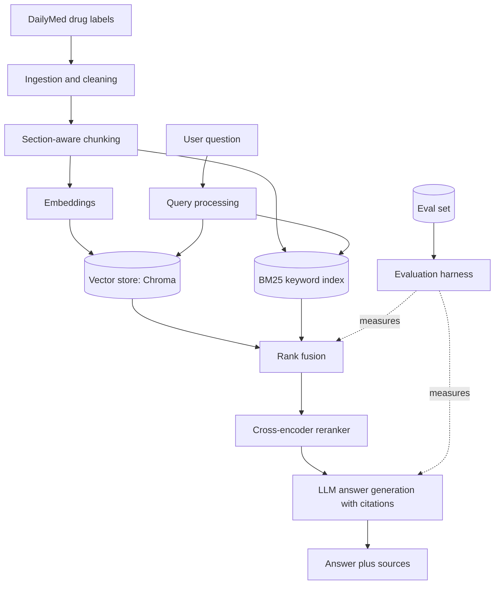

# Drug Label RAG Assistant

[](https://github.com/<your-username>/drug-label-rag/actions/workflows/ci.yml)


A retrieval-augmented generation (RAG) system that answers questions about FDA drug labels, with source citations and a built-in evaluation harness that measures **retrieval quality** and **answer faithfulness** on every change.

> **Project status:** in active development. Sections marked **(planned)** describe the target design and are not built yet. The [Roadmap](#roadmap) tracks progress, and the [Results](#results) table is filled in only with measured numbers.

<!-- Replace with a real demo GIF once the UI exists:

-->

---

## Table of contents

- [Overview](#overview)
- [Key features](#key-features)
- [Architecture](#architecture)
- [Tech stack](#tech-stack)
- [Project structure](#project-structure)
- [Getting started](#getting-started)
- [Configuration](#configuration)
- [Usage](#usage)
- [Data pipeline](#data-pipeline)
- [Retrieval and generation design](#retrieval-and-generation-design)
- [Evaluation](#evaluation)
- [Results](#results)
- [Design decisions](#design-decisions)
- [Testing and CI](#testing-and-ci)
- [Limitations](#limitations)
- [Roadmap](#roadmap)
- [Safety and data](#safety-and-data)
- [Contributing](#contributing)
- [License](#license)

---

## Overview

Drug labels are long, dense, and structured: indications, dosage, contraindications, warnings, interactions, adverse reactions. Answering a question like *"Can this medication be combined with an anticoagulant?"* means finding the right section of the right label and quoting it accurately.

This project builds that workflow end to end and, more importantly, **measures whether it works**. Each retrieval or prompting change is evaluated against a fixed test set, so improvements (and regressions) show up as numbers rather than impressions.

**Goals**

- Answer questions grounded in the source label text, with citations to the exact section
- Refuse or flag uncertainty when the labels do not contain the answer
- Make every design choice defensible with evaluation results

## Key features

| Feature | Description | Status |
| --- | --- | --- |
| Section-aware ingestion | Parses labels into their official sections instead of arbitrary character windows | Planned |
| Hybrid retrieval | Dense embeddings plus keyword (BM25) search, merged with reciprocal rank fusion | Planned |
| Reranking | Cross-encoder reranker to sharpen the top results | Planned |
| Cited answers | Every claim links back to a label, section, and passage | Planned |
| Abstention | Says "not found in the provided labels" rather than guessing | Planned |
| Evaluation harness | Recall@k, MRR, and faithfulness scoring over a curated question set | Planned |
| API and demo UI | FastAPI service and Streamlit front end | Planned |

## Architecture



## Tech stack

| Layer | Choice | Notes |
| --- | --- | --- |
| Language | Python 3.11+ | |
| API | FastAPI | Typed request and response models |
| Vector store | Chroma | Local and simple for a portfolio project |
| Keyword search | `rank_bm25` | Complements dense retrieval on exact drug names and terms |
| Embeddings | To be chosen via eval | Candidates compared in [Design decisions](#design-decisions) |
| Reranker | Cross-encoder | Compared against no reranking |
| LLM | Configurable provider | Set by environment variable |
| UI | Streamlit | Demo front end |
| Testing | pytest | Unit and integration tests |
| CI | GitHub Actions | Lint, test, and a small eval smoke test |

## Project structure

```
drug-label-rag/
├── README.md
├── LICENSE
├── pyproject.toml
├── .env.example
├── .github/
│   └── workflows/
│       └── ci.yml
├── src/
│   └── drug_label_rag/
│       ├── ingestion/      # download, parse, clean labels
│       ├── chunking/       # section-aware splitting
│       ├── retrieval/      # dense, BM25, fusion, reranking
│       ├── generation/     # prompts, citation formatting, abstention
│       ├── api/            # FastAPI app
│       └── config.py
├── app/
│   └── streamlit_app.py
├── evals/
│   ├── questions.jsonl     # question, reference answer, source passage
│   ├── run_eval.py
│   └── results/            # committed eval reports
├── tests/
├── docs/
│   ├── architecture.md
│   └── decisions/          # short decision records
└── scripts/
```

## Getting started

### Prerequisites

- Python 3.11 or newer
- An API key for your chosen LLM provider
- About 2 GB of free disk space for the sample corpus and index

### Installation

```bash
git clone https://github.com/<your-username>/drug-label-rag.git
cd drug-label-rag
python -m venv .venv && source .venv/bin/activate
pip install -e ".[dev]"
cp .env.example .env   # then add your API key
```

### Build the index

```bash
python -m drug_label_rag.ingestion.build --limit 500
```

### Run the app

```bash
uvicorn drug_label_rag.api.main:app --reload   # API on http://localhost:8000
streamlit run app/streamlit_app.py             # demo UI
```

> The commands above are the **target interface**. They will work as the roadmap items land.

## Configuration

All settings come from environment variables. Copy `.env.example` to `.env`.

| Variable | Purpose | Default |
| --- | --- | --- |
| `LLM_PROVIDER` | Which LLM provider to call | none |
| `LLM_API_KEY` | API key for that provider | none |
| `EMBEDDING_MODEL` | Embedding model name | set after eval |
| `CHROMA_PATH` | Where the vector index is stored | `./data/chroma` |
| `TOP_K` | Passages retrieved before reranking | `20` |
| `RERANK_TOP_N` | Passages kept after reranking | `5` |

Never commit `.env`. It is listed in `.gitignore`.

## Usage

### API

```bash
curl -X POST http://localhost:8000/ask \
  -H "Content-Type: application/json" \
  -d '{"question": "What are the contraindications for this drug?", "drug": "example-drug"}'
```

Target response shape:

```json
{
  "answer": "Text grounded in the label, with inline citation markers [1].",
  "citations": [
    {"id": 1, "label": "Drug name", "section": "Contraindications", "passage": "..."}
  ],
  "abstained": false
}
```

### Evaluation

```bash
python evals/run_eval.py --config configs/baseline.yaml
```

## Data pipeline

1. **Source:** public drug label data from [DailyMed](https://dailymed.nlm.nih.gov/dailymed/) (U.S. National Library of Medicine).
2. **Parse:** extract the structured sections (indications, dosage, contraindications, warnings, interactions, adverse reactions).
3. **Clean:** strip boilerplate, normalize whitespace and units, keep section metadata.
4. **Chunk:** split within sections, preserving the drug name and section title on every chunk so retrieved passages are self-explanatory.
5. **Index:** embed chunks into Chroma and build the BM25 index.

## Retrieval and generation design

- **Hybrid retrieval.** Dense search handles paraphrased questions, while BM25 handles exact drug names and clinical terms that embeddings can blur. Results are merged with reciprocal rank fusion.
- **Reranking.** A cross-encoder rescored the merged candidates. Its impact is measured, not assumed.
- **Grounded generation.** The prompt restricts the model to the retrieved passages and requires a citation for each claim.
- **Abstention.** If retrieved evidence is weak, the system says so instead of answering from the model's general knowledge.

## Evaluation

Evaluation is the core of this project.

**Eval set.** A curated file of 50+ questions, each with a reference answer and the source passage that supports it. Questions cover straightforward lookups, multi-section questions, and **unanswerable** questions that test abstention.

**Retrieval metrics**

- Recall@k: whether the correct source passage appears in the top k results
- MRR: how high the correct passage ranks

**Answer metrics**

- Faithfulness: whether each claim is supported by the retrieved passages
- Answer correctness against the reference answer
- Abstention accuracy on unanswerable questions

**Process.** Every configuration change is run through `evals/run_eval.py`, and the report is committed to `evals/results/` so the history is reviewable.

## Results

Results will be added here as they are measured. No numbers are reported until the eval harness runs.

| Configuration | Recall@5 | MRR | Faithfulness | Abstention accuracy |
| --- | --- | --- | --- | --- |
| Dense only (baseline) | TBD | TBD | TBD | TBD |
| + BM25 hybrid | TBD | TBD | TBD | TBD |
| + Reranker | TBD | TBD | TBD | TBD |

## Design decisions

Each choice below will link to a short decision record in `docs/decisions/` once it is backed by eval results.

| Decision | Options compared | Outcome |
| --- | --- | --- |
| Chunking strategy | Fixed-size vs section-aware | TBD |
| Embedding model | Two or three candidates | TBD |
| Retrieval | Dense only vs hybrid | TBD |
| Reranking | With vs without | TBD |
| Top-k and context size | Several values | TBD |

## Testing and CI

- **Unit tests** cover parsing, chunking, and citation formatting.
- **Integration tests** run the pipeline on a tiny fixture corpus.
- **Eval smoke test** runs a small subset of the eval set in CI to catch regressions.
- **GitHub Actions** runs linting and tests on every push and pull request.

```bash
pytest
ruff check .
```

## Limitations

- Covers a sample of labels, not the full DailyMed catalog
- Labels change over time, so the index can go stale without re-ingestion
- Faithfulness scoring is itself imperfect and is spot-checked by hand
- This is a learning and portfolio project, not a clinical tool

## Roadmap

- [x] Repository scaffold and README
- [ ] Ingest and clean a sample of DailyMed labels
- [ ] Section-aware chunking
- [ ] Baseline dense retrieval with cited answers
- [ ] Eval set of 50+ questions and the evaluation harness
- [ ] BM25 hybrid retrieval and reranking, with before/after results
- [ ] Abstention handling
- [ ] FastAPI service and Streamlit demo
- [ ] Tests and GitHub Actions CI
- [ ] Demo GIF and published results

## Safety and data

- Uses only **public, non-personal data**. No patient records and no proprietary data.
- **Not medical advice.** Outputs are for demonstration and should never guide treatment decisions. Consult a licensed professional.

## Contributing

Issues and suggestions are welcome. For code changes, open an issue first to discuss the approach, then submit a pull request with tests.

## License

MIT. See [LICENSE](LICENSE).

## Acknowledgments

Label data courtesy of the U.S. National Library of Medicine's DailyMed.
